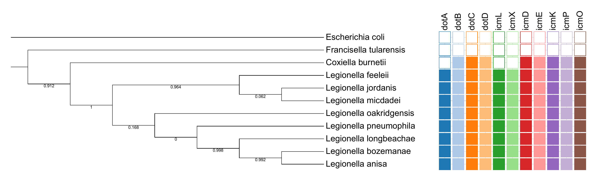

# Legionella-DotIcm-Phylogeny

Mini comparative-genomics project exploring the conservation of the Dot/Icm type IVB secretion system across the *Legionella* genus.

## Question

Is the Dot/Icm secretion system (the molecular "syringe" *Legionella* uses to survive inside host cells) conserved across the genus, and is it shared with related intracellular bacteria?

## Data

11 RefSeq proteomes downloaded from NCBI Datasets on [DATE] (accessions listed in `genomes.tsv`):

- 8 *Legionella* species: *L. pneumophila*, *L. longbeachae*, *L. micdadei*, *L. oakridgensis*, *L. feeleii*, *L. jordanis*, *L. bozemanae*, *L. anisa*
- *Coxiella burnetii* (close relative)
- *Francisella tularensis* (more distant relative)
- *Escherichia coli* K-12 (outgroup)

## Methods

- **Species tree**: the *rpoB* protein was extracted from each proteome and analysed with the NGPhylogeny.fr One Click workflow (PhyML). The tree was rooted on *E. coli* and visualised in iTOL.
- **Gene content analysis**: 11 Dot/Icm proteins from *L. pneumophila* (dotA, dotB, dotC, dotD, icmD, icmE, icmK, icmL, icmO, icmP, icmX) were used as BLASTP queries against each proteome. The best hit was chosen by bitscore, and a gene was scored **present** at ≥30% identity and ≥50% query coverage.
- **Validation**: a reciprocal best-hit test was applied to the DotB-like hits in *E. coli* and *Francisella*.

## Results

*Figure 1. rpoB protein tree of 11 bacteria, rooted on E. coli (branch lengths not shown; numbers are branch support values, 0 to 1), with presence (filled) or absence (empty) of 11 Dot/Icm genes. Presence: ≥30% identity and ≥50% query coverage. DotB in E. coli and Francisella failed the reciprocal best-hit test and is scored absent.*

- All 8 *Legionella* species carried all 11 Dot/Icm genes. The genus formed one strongly supported group (support 1).
- Eight of the 11 genes were detected in *Coxiella burnetii*. dotA, icmL and icmX fell below the threshold (best hits 31.5%, 25.2% and 28.3% identity), so they are "not detected", not proven absent.
- No Dot/Icm genes were detected in *Francisella tularensis* or *E. coli*. DotB-like hits (38% and 32% identity) failed the reciprocal best-hit test and were scored absent.

**Interpretation**: the Dot/Icm system appears to be a conserved core feature of *Legionella* and is shared with *Coxiella*, consistent with its presence in their common ancestor.

## Quality control

- An empty input file (*L. oakridgensis*) was detected and replaced.
- Best-hit selection was changed from identity to bitscore after a short fragment outranked the full-length match for *L. longbeachae* dotA.
- DotB hits in *E. coli* and *Francisella* were tested with a reciprocal best-hit search.

## Limitations

- Single-gene (*rpoB*) tree: relationships only, no molecular dating.
- Branch support is high for the *Legionella* genus (1) but low for the order of early splits within it (0 to 0.17), so within-genus relationships are not interpreted.
- Presence/absence rests on BLAST thresholds, and only DotB received a reciprocal check.
- Divergent genes may be missed by BLAST (profile HMM methods would be more sensitive).
- Presence of a gene does not show it is functional.
- Small sample (8 *Legionella* species, one gene system).

## Reproduce

Place the 11 `.faa` files (accessions in `genomes.tsv`) in one folder with the scripts from `04_DotIcm/`. Requires BLAST+ and Python 3. Run `dot_icm_check.py`, then `rbh_dotB.py`, then `finalise.py`.

## Repository contents

- `genomes.tsv`: genomes and accessions
- `02_Markers/rpoB_all.fasta`: extracted rpoB sequences
- `03_Tree/PhyML_newick_tree.nhx`: phylogenetic tree
- `04_DotIcm/`: presence/absence tables and analysis scripts
- `05_Figures/`: final figure
- `06_Final/`: one-page report (PDF)
